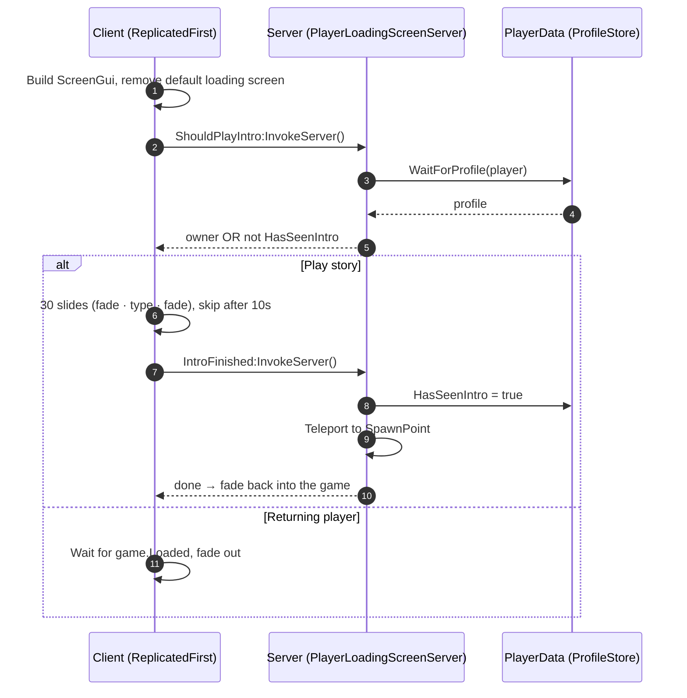

<p align="center">
  
</p>

<h1 align="center">Open Sourced Roblox Loading Screen</h1>

<p align="center">
  <b>A cinematic, story-driven first-join loading screen for Roblox, written in Luau.</b><br/>
  <sub>30 illustrated story beats · typed narration · horror vignette · skip hint · saved "seen" flag</sub>
</p>

<p align="center">
  
  
  
  
  
</p>

<p align="center">
  
</p>

<p align="center"></p>

## 🎬 Preview

<p align="center">
  
</p>

<p align="center"><sub>Animated mock-up of the layout. In game, each slide is one of your own story images.</sub></p>

## ✨ Features

| | Feature | Details |
|---|---|---|
| 🕯️ | **Story sequence** | 30 image + text beats, each fading in (1s), holding (5s) and fading out (1.5s) with a slow push-in zoom |
| ⌨️ | **Typed narration** | Each line types itself out and finishes halfway through the image's display time |
| 🩸 | **Horror styling** | Black → blood-red edge vignette (centre stays fully clear), letterbox bars, typewriter font, bone-to-blood `UIGradient` + `UIStroke` on the text |
| ⏭️ | **Skip hint** | "Click anywhere to skip" fades in bottom-right after 10s and pulses; mouse, touch or gamepad **A** skips |
| 🔊 | **Audio** | Looping music that fades in and out, plus a skip sting |
| 🚀 | **ReplicatedFirst** | Shows from the very first frame and replaces Roblox's default loading screen |
| 🧱 | **Built in code** | Every UI element is created by the LocalScript; nothing to set up in StarterGui |
| 💾 | **Shows once** | New players see it once (saved with ProfileStore); the game owner always sees it |
| 📍 | **Spawn teleport** | When it ends or is skipped, the player is moved to `Workspace.LoadingScreenRelated.SpawnPoint` behind a black fade |
| ⚡ | **Optimized** | One reusable `ImageLabel`, background preloading, cancelled stray tweens, GUI destroyed when done |

## 🧠 How it works



## 📁 Project structure

```text
Roblox-Loading-Screen/
├─ default.project.json                 # Rojo project (also creates the remotes)
├─ src/
│  ├─ ReplicatedFirst/
│  │  └─ PlayerLoadingScreen.client.luau  # UI + story sequence (LocalScript)
│  └─ ServerScriptService/
│     └─ Mechanism/
│        ├─ PlayerLoadingScreenServer.server.luau
│        └─ DataRelated/
│           ├─ PlayerData.luau            # ProfileStore session manager
│           └─ ProfileStore  ← add this (see Dependencies)
└─ assets/                               # README artwork
```

## 🛠️ Installation

### Option A: Roblox Studio (manual)

1. **ReplicatedFirst** → add a `LocalScript` named `PlayerLoadingScreen` and paste
   [`PlayerLoadingScreen.client.luau`](src/ReplicatedFirst/PlayerLoadingScreen.client.luau).
2. **ServerScriptService** → create `Mechanism/DataRelated/`:
   - `Mechanism` → `Script` named `PlayerLoadingScreenServer` ← [`PlayerLoadingScreenServer.server.luau`](src/ServerScriptService/Mechanism/PlayerLoadingScreenServer.server.luau)
   - `DataRelated` → `ModuleScript` named `PlayerData` ← [`PlayerData.luau`](src/ServerScriptService/Mechanism/DataRelated/PlayerData.luau)
   - `DataRelated` → `ModuleScript` named `ProfileStore` ← [ProfileStore](https://github.com/MadStudioRoblox/ProfileStore)
3. **ReplicatedStorage** → create `Mechanism/LoadingScreenRemotes/` containing two `RemoteFunction`s:
   `ShouldPlayIntro` and `IntroFinished`.
4. **Workspace** → create a folder `LoadingScreenRelated` with an anchored `Part` named `SpawnPoint`.
5. **Game Settings → Security** → turn on **Enable Studio Access to API Services** so data saves while testing.

### Option B: Rojo

```bash
rojo serve
```

The project file maps the scripts and creates the `LoadingScreenRemotes`. You still need to add
`ProfileStore` to `src/ServerScriptService/Mechanism/DataRelated/` and the `SpawnPoint` part in Studio.

## ⚙️ Configuration

All tuning lives at the top of `PlayerLoadingScreen.client.luau`:

| Setting | Default | What it does |
|---|---|---|
| `FADE_IN_TIME` | `1` | Seconds each image fades in |
| `DISPLAY_TIME` | `5` | Seconds each image is fully visible; text finishes typing at half of this |
| `FADE_OUT_TIME` | `1.5` | Seconds the image and text fade out |
| `SKIP_DELAY` | `10` | Seconds before the skip hint appears |
| `MUSIC_ID` / `SKIP_SOUND_ID` | APM tracks | Background music and skip sting |
| `MUSIC_VOLUME` | `0.5` | Music volume after fade-in |
| `ZOOM_SCALE` | `1.06` | Push-in zoom amount per slide |
| `SEQUENCE` | 30 entries | `{ imageId, storyLine }` pairs, played in order |

To tell your own story, replace the entries in `SEQUENCE` with your image IDs and lines. Any length works.

Saved data lives in `PlayerData.luau` (`STORE_NAME = "PlayerData_v1"`, `PROFILE_TEMPLATE`). Add more fields there and `Reconcile()` fills them in for existing players.

## 📦 Dependencies

| Dependency | Author | License | Used for |
|---|---|---|---|
| [**ProfileStore**](https://github.com/MadStudioRoblox/ProfileStore) | loleris (MAD STUDIO) | Apache-2.0 | Session-locked player data (the "has seen intro" flag) |
| [Rojo](https://rojo.space) *(optional)* | Rojo contributors | MPL-2.0 | Syncing the files into Studio |

Roblox services used: `ReplicatedFirst`, `TweenService`, `ContentProvider`, `UserInputService`, `StarterGui`, `GroupService`, `DataStoreService` (through ProfileStore).

## 🙏 Credits

- **[ProfileStore](https://github.com/MadStudioRoblox/ProfileStore)** by **loleris / MAD STUDIO**: the data layer this project is built on. Not bundled here; get it from the official repository.
- **Music:** *"Melancholy Martenot"* ([`1842248801`](https://create.roblox.com/store/asset/1842248801)), KPM 1000 LP Series, **courtesy of APM Music**, published on Roblox by *APMOfficial*.
- **Skip sting:** *"Rider Sting 3"* ([`1843987583`](https://create.roblox.com/store/asset/1843987583)), **APM Music**, published on Roblox by *APMOfficial*.
- **Font:** *Special Elite* by **Astigmatic**, shipped with Roblox.
- **Story artwork:** the 30 images referenced in `SEQUENCE` belong to the author's game. Please swap in your own.
- **Readme extras:** [shields.io](https://shields.io) badges and [readme-typing-svg](https://github.com/DenverCoder1/readme-typing-svg) by DenverCoder1.

## 📜 License

Source code is released under the [MIT License](LICENSE). Third-party dependencies and assets keep their own licenses and ownership (see above).

<p align="center"></p>

<p align="center">
  Made with 🩸 by <a href="https://github.com/Xyvanned"><b>Xyvan</b></a> · If this helped, leave a ⭐
</p>
